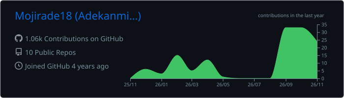
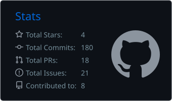

 

 

  

 

**Bridging hardware and software to build intelligent systems.**

 

---

## 👩🏽‍💻 About Me

I'm a Computer Engineering student at **Obafemi Awolowo University (OAU), Nigeria**, interested in understanding how hardware and software come together to create useful, intelligent systems.

My interests lie in embedded systems, firmware development, the Internet of Things (IoT), and System-on-Chip (SoC) technologies. I enjoy learning by building, experimenting with development boards, exploring protocols, and working through practical engineering challenges.

I'm currently developing my skills across the hardware and software layers, from microcontrollers and sensors to communication technologies and cloud-connected devices.

- 🎓 Computer Engineering student at Obafemi Awolowo University.
- 🔧 Exploring embedded systems, firmware, ARM architecture and SoC development.
- 🌐 Learning how connected devices communicate through IoT protocols and wireless technologies.
- 💻 Building practical projects and documenting my engineering journey.
- 🌱 Always learning, experimenting and looking for opportunities to contribute.

---

## 🧰 Tech Arsenal

The tools and technologies I'm learning and working with:

### Programming Languages

  

### Embedded Systems & Hardware

  

**Also exploring:** ESP32, STM32, ARM architecture, SystemVerilog, FPGA development, sensors, RFID and microcontroller peripherals.

### Development Tools & Design

  

**Also using:** Arduino IDE, STM32CubeIDE, Quartus, Proteus, KiCad, LTspice and VS Code.

### IoT & Communication Technologies

`MQTT` · `Bluetooth Low Energy (BLE)` · `LoRa` · `WPAN` · `WLAN` · `AWS IoT`

---

## ⚙️ Engineering Interests

### Embedded Systems & Firmware

I'm interested in the software that brings electronic systems to life. My learning journey involves working with microcontrollers, sensors, GPIO, peripheral interfaces and firmware development.

Areas I'm exploring:
- Microcontroller programming with C/C++.
- ESP32 and STM32 development.
- GPIO, timers and peripheral communication.
- Sensor interfacing and data acquisition.
- Firmware structure and debugging.

### ARM Architecture & System-on-Chip

I'm exploring ARM-based systems and how different components work together within a System-on-Chip.

My learning includes:
- ARM architecture and assembly language fundamentals.
- ARM C toolchains and linker workflows.
- GEM5-based SoC simulation.
- SystemVerilog fundamentals.
- FPGA development and digital logic design.
- Understanding performance, power and area trade-offs.

### Internet of Things

I'm interested in building connected systems that collect data, communicate with other devices and support useful real-world applications.

Technologies I'm exploring include:
- MQTT and device-to-cloud communication.
- Bluetooth and other wireless communication technologies.
- LoRa, WPAN and WLAN.
- AWS IoT and cloud-connected practicals.
- Sensor-based monitoring systems.

---

## 🚀 Projects & Hands-on Experience

Here are some of the projects and practical experiments I've worked on or am currently exploring.

| Project | Description | Technologies |
|---|---|---|
| [Arduino Starter Lab](https://github.com/Mojirade18/arduino-starter) | A beginner-friendly repository for learning Arduino through practical experiments, including an LDR-controlled LED, binary counter, water leak detector simulation and clap switch. | Arduino, C/C++ |
| OAU Transport RFID Ticketing System | An ongoing project concept exploring an RFID-based ticketing solution for OAU transportation, with the goal of reducing reliance on paper tickets. | ESP32-S3, RC522, RFID |
| Ecoloop | An ongoing environmental project exploring air-quality monitoring, pollution prediction and creative approaches to waste awareness and reuse. | MQ135, IoT, Environmental Monitoring |
| Virtual Environmental Monitoring SoC | A simulated ARM-based environmental monitoring system exploring temperature, humidity and air-quality data, threshold checks and alerts without physical hardware. | ARM, SoC, GEM5, IP Explorer |
| FPGA & SystemVerilog Labs | Practical learning exercises involving digital logic, SystemVerilog data types and simple state-machine designs on an FPGA development board. | SystemVerilog, Quartus, DE1 FPGA |
| STM32 GPIO Experiments | Hands-on exploration of STM32 development, including GPIO output control, LED blinking and basic peripheral configuration. | STM32CubeIDE, C, STM32 HAL |
| Cloud IoT Practicals | Practical exercises exploring cloud-connected IoT systems and how devices can communicate with cloud services. | AWS, IoT |

---

## 🌍 Open Source & Community

I enjoy being part of communities where people learn together, share knowledge and build opportunities for others to grow in technology.

### Community Roles

- **Open Source Lead — She Code Africa (SCA), OAU Chapter:** Supporting open-source learning, community activities and contributor engagement.
- **Chapter Lead — Women at the Table (WAAW), OAU Chapter:** Supporting initiatives that encourage girls and women to explore STEM.
- **Programs and Events Lead — AWS OAU Student Branch:** Supporting the planning and coordination of student-focused technical programmes and events.
- **Huawei ICT Competition 2026 Ambassador:** Supporting awareness and student participation in the competition.
- **ChipMango Silicon Foundations Mentee:** Learning about semiconductor and silicon engineering fundamentals.

### Open Source Contributions

- Participated in Hacktoberfest 2025, completing **6 pull requests**.
- Maintained automation workflows for the SCA OAU LearnLink Hacktoberfest 2026 activities.
- Worked with GitHub Actions to support community contribution workflows.
- Built and maintained beginner-friendly Arduino learning resources through Arduino Starter Lab.

---

## 📚 Currently Learning

I'm continuously developing my understanding of the technologies behind embedded and connected systems.

- Embedded C and C++ development.
- ARM architecture, assembly and SoC fundamentals.
- SystemVerilog and digital design.
- STM32 and ESP32 microcontroller development.
- Wireless communication technologies.
- MQTT and cloud-connected IoT systems.
- Hardware-software integration.

---

## 📊 GitHub Statistics

  

  

---

## 🤝 Let's Connect

I'm always happy to connect with fellow students, developers, engineers, open-source contributors and people working on interesting technology projects.

Whether it's embedded systems, IoT, hardware development, open source or a learning opportunity, feel free to reach out.

  

**Thanks for stopping by! ☕**

*Learning, building and connecting ideas — one project at a time.*

