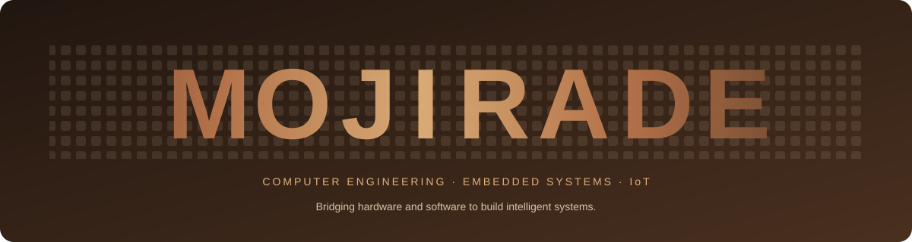

 

 

  

 

**Bridging hardware and software to build intelligent systems.**

 

---

## 👩🏽‍💻 About Me

I'm a Computer Engineering student at **Obafemi Awolowo University (OAU), Ile-Ife, Nigeria**, interested in the intersection of hardware, software and intelligent systems.

My main focus is embedded systems and hardware-software integration. I'm learning how to build systems that interact with the physical world, process information and communicate with other devices.

I enjoy moving between different layers of engineering: writing firmware, interfacing sensors, exploring microcontrollers, experimenting with communication protocols and understanding the architecture behind computing systems.

I'm still growing my engineering experience, and I document much of that process through practical projects, experiments and open-source contributions.

- 🎓 Computer Engineering undergraduate at OAU.
- 🔧 Exploring embedded systems, firmware and microcontroller development.
- ⚙️ Learning ARM architecture, System-on-Chip design and digital logic.
- 🌐 Interested in IoT, wireless communication and connected devices.
- 💻 Building with C/C++, Arduino, ESP32, STM32 and other engineering tools.
- 🌱 Learning in public, building consistently and contributing to communities.

---

## ⚙️ Engineering Focus

### 01. Embedded Systems & Firmware

My primary area of interest is building systems that connect software to the physical world.

I'm exploring how microcontrollers interact with sensors, peripherals and other electronic components, and how firmware controls the behaviour of these systems.

**Areas I'm working through:**
- Embedded C and C++ programming.
- Arduino and ESP32 development.
- STM32 development using STM32CubeIDE and HAL.
- GPIO, timers and peripheral configuration.
- Sensor interfacing and data acquisition.
- Firmware debugging and program structure.

### 02. ARM Architecture & System-on-Chip

I'm developing an understanding of how processors, memory, peripherals and other IP blocks come together to form a complete computing system.

My learning includes:
- ARM architecture fundamentals.
- ARM C and assembly language.
- Toolchains, compilation and linking.
- GEM5-based system simulation.
- SoC architecture and IP integration.
- Power, performance and area (PPA) considerations.
- SystemVerilog and digital design fundamentals.

### 03. IoT & Connected Systems

I'm interested in how devices collect information, communicate and interact with cloud services to support real-world applications.

**Technologies and concepts:**
- MQTT and publish-subscribe communication.
- Bluetooth Low Energy (BLE).
- LoRa communication.
- WPAN and WLAN.
- RFID-based identification.
- AWS IoT and cloud-connected practicals.
- Edge, fog and cloud computing.

### 04. Digital Logic & FPGA Development

I'm also building my foundation in digital hardware design and understanding how logic translates into working circuits.

**Current learning areas:**
- Verilog and SystemVerilog fundamentals.
- Combinational and sequential logic.
- Finite State Machines.
- FPGA development using Quartus.
- Simulation and basic hardware testing.

---

## 🛠️ Engineering Projects

My projects are organised around the different areas of engineering I'm exploring. Some are completed learning experiments, while others are ongoing projects and concepts I'm developing.

### 🔌 Embedded Systems & Microcontroller Projects

| # | Project | What it explores |
|---|---|---|
| 1 | **Arduino Starter Lab** | A beginner-friendly collection of Arduino experiments, including LDR-controlled LEDs, a binary counter, a water leak detector simulation and a clap switch |
| 2 | **OAU Transport RFID Ticketing System** | An RFID-based ticketing concept intended to reduce paper ticket usage in OAU transportation |
| 3 | **STM32 GPIO Experiments** | Microcontroller programming, GPIO output control, LED blinking and basic STM32 peripheral exploration |
| 4 | **Sensor Interfacing Experiments** | Working with electronic sensors and understanding how microcontrollers receive and process physical-world data |

**Arduino Starter Lab**

A practical learning repository created to make it easier for beginners to explore Arduino through small, understandable projects.

- LDR-based automatic LED control.
- 7-bit binary button counter (0–127).
- Water leak detector simulation.
- Clap switch.

**Stack:** `Arduino` `C/C++` `Sensors` `Electronics`

[Explore Arduino Starter Lab →](https://github.com/Mojirade18/arduino-starter)

**OAU Transport RFID Ticketing System**

An ongoing project concept exploring how RFID technology can improve ticketing for OAU transportation. The system uses an ESP32-S3 and RC522 RFID reader as the foundation for experimenting with card identification and a digital ticketing workflow.

**Stack:** `ESP32-S3` `RC522` `RFID` `Embedded C/C++`

### 🌐 IoT & Environmental Systems

| # | Project | What it explores |
|---|---|---|
| 1 | **Ecoloop** | Environmental monitoring, air-quality sensing, pollution prediction and waste awareness |
| 2 | **Virtual Environmental Monitoring SoC** | A simulated environmental monitoring system using temperature, humidity and air-quality data |
| 3 | **Cloud IoT Practicals** | Device-to-cloud communication and practical exploration of cloud-connected IoT systems |

**Ecoloop**

An ongoing environmental technology project exploring how sensing and data-driven approaches can support environmental awareness. The concept includes air-quality monitoring using an MQ135 sensor, pollution prediction and creative approaches to waste awareness and reuse.

**Stack:** `MQ135` `IoT` `Environmental Monitoring` `Data`

**Virtual Environmental Monitoring SoC**

A simulated ARM-based environmental monitoring system developed while exploring SoC architecture and IP integration. The concept uses simulated temperature, humidity and air-quality readings, with threshold checks and alerts to demonstrate how different system components can work together.

**Stack:** `ARM` `SoC` `GEM5` `IP Explorer` `Embedded Systems`

**Cloud IoT Practicals**

Hands-on learning focused on connecting IoT concepts with cloud services. These practicals explore device communication, cloud infrastructure and the role of cloud platforms in connected systems.

**Stack:** `AWS` `Cloud IoT` `MQTT`

### 🧠 Digital Design, FPGA & Computer Architecture

| # | Project / Lab | What it explores |
|---|---|---|
| 1 | **SystemVerilog Data Types** | Understanding logic values, variables, data types, `$display`, `$monitor` and simulation output |
| 2 | **Traffic Light Controller** | Exploring enumerated states and finite state machine behaviour |
| 3 | **DE1 FPGA Experiments** | Basic digital logic implementation and FPGA development using Quartus |
| 4 | **ARM & SoC Labs** | Processor architecture, assembly, toolchains and simulated SoC development |

**Stack:** `SystemVerilog` `Verilog` `Quartus` `FPGA` `ARM`

---

## 💻 Technology Stack

### Programming Languages

### Embedded Systems & Hardware

`ESP32` · `STM32` · `ARM` · `FPGA` · `SystemVerilog` · `Sensors` · `RFID`

### Development & Engineering Tools

`Arduino IDE` · `STM32CubeIDE` · `Quartus` · `Proteus` · `KiCad` · `LTspice` · `GEM5`

### Communication & Cloud Technologies

`MQTT` · `Bluetooth Low Energy` · `LoRa` · `WPAN` · `WLAN` · `AWS IoT`

---

## 🌍 Open Source & Community

Beyond building technical projects, I'm passionate about creating spaces where people can learn, collaborate and grow in technology.

### Community Leadership

| Community | Role | Contribution |
|---|---|---|
| **She Code Africa (SCA), OAU** | Open Source Lead | Supporting open-source learning, contributor engagement and community initiatives |
| **WAAW, OAU Chapter** | Chapter Lead | Supporting STEM opportunities and initiatives for girls and young women |
| **AWS OAU Student Branch** | Programs and Events Lead | Supporting the planning and coordination of technical programmes and community events |
| **Huawei ICT Competition 2026** | Ambassador | Supporting awareness and student participation in the competition |
| **ChipMango Silicon Foundations** | Mentee | Learning about semiconductor and silicon engineering fundamentals |

### Open Source Contributions

- Participated in **Hacktoberfest 2025**, completing 6 pull requests.
- Maintained GitHub Actions automation workflows for SCA OAU LearnLink Hacktoberfest 2026.
- Worked on pull request automation, issue automation, CI checks and contributor workflows.
- Created Arduino Starter Lab as a practical learning resource for beginners.
- Participated in open-source community activities and collaborative projects.

---

## 📖 Learning & Development

I'm continuously strengthening my engineering foundation through coursework, technical programmes, practical labs and independent projects.

| Area | Current learning |
|---|---|
| Embedded Systems | Microcontroller programming, peripherals and firmware |
| ARM & SoC | ARM architecture, assembly, toolchains and SoC simulation |
| Digital Design | Verilog, SystemVerilog, FPGA and finite state machines |
| IoT | MQTT, wireless communication and connected devices |
| Cloud | AWS cloud and IoT practicals |
| Hardware Design | Circuit simulation, PCB design concepts and electronics tools |

---

## 🎓 Background

**Obafemi Awolowo University (OAU)**

Bachelor's degree programme in Computer Engineering.

I am building a foundation across computer hardware, software, electronics, digital systems and computer architecture, while exploring how these disciplines come together in practical engineering applications.

**Location:** Ile-Ife, Nigeria.

---

## 📊 GitHub Analytics

  

  

---

## 🤝 Let's Connect

I'm open to connecting with engineers, developers, students, open-source contributors and communities working on interesting technology.

If you're exploring embedded systems, IoT, hardware development, ARM/SoC or open source, I'd love to connect and learn from what you're building.

  

**Learning. Building. Connecting ideas.**

*One experiment, one project and one lesson at a time.*

